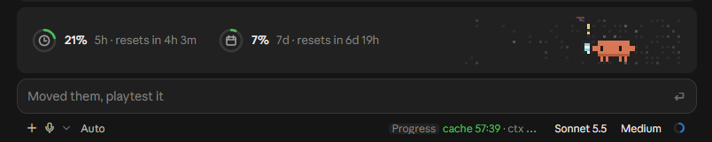

# pixel-buddy
Simple Claude Code plugin that shows usage meters, and a cache timer. That's really about it.

The 5h and 7d meters also show what each window has cost in dollars, priced at API rates from every session transcript on this machine (`~/.claude/projects`). In the desktop app, hover or click the ⓘ after the 7d meter for a usage card: dollars left before each limit, the projected percent at reset, how many sessions are working or waiting on you, and the threads or projects that spent the window.

```
/plugin marketplace add hamymarnie/marnie-plugins
/plugin install pixel-buddy@marnie-plugins
```